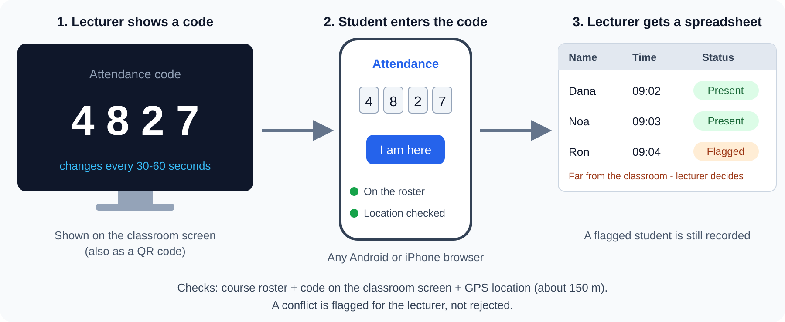

# Class Attendance & Teaching Tool

A simple web-based tool for teaching in class. Students use it from any smartphone through the browser, with nothing to install.

> Course: Introduction to Software Engineering, Ariel University
> Ex2 - Vibe Coding & Deep Designing | Author: May Caspi and Haim Barabi

## Problem

Taking attendance in class is slow and manual, and current online teaching tools are too complicated. We want a simple tool that works in a real classroom, on students' own phones.

## Goal

Design an end-to-end web application for teaching in class. The assignment is mainly a design challenge, and the main feature is **automatic attendance**.

## How it works

1. The lecturer uploads the course roster once, and opens attendance from their phone inside the classroom. The system saves that location as the classroom location.
2. A code (also shown as a QR code) appears on the classroom screen and changes every 10-30 seconds.
3. A student on the roster opens the web page on their phone, enters the code, and is marked present.
4. The lecturer receives an online/offline spreadsheet with the attendance details.

## Presence checks

- **Course roster:** only registered students can mark attendance, so students from other classes are excluded.
- **Code on the classroom screen:** proves the student can see the screen in the room.
- **GPS location:** the student must be within about 150 meters of the classroom, which filters out students in far places such as the library.
- **Flag for the lecturer:** if the code is valid but the location is far, the student is flagged, not rejected. The lecturer decides.

No method is 100% cheat-proof, and known limitations will be documented in the design.

## Scope

- **Implemented in the demo:** attendance (roster, changing code, location check, lecturer spreadsheet) and lecturer polls
- **Design only:** student comments and the class summary
- **Not included:** LLM homework review, and integration with Moodle, Zoom, or personal information systems