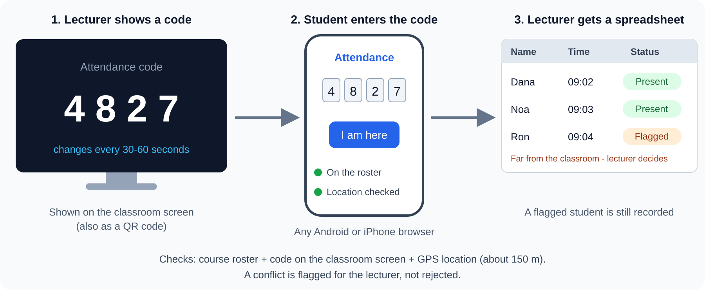

# Class Attendance & Teaching Tool

A simple web-based tool for teaching in class. Students use it from any smartphone through the browser, with nothing to install.

> Course: Introduction to Software Engineering, Ariel University
> Ex2 - Vibe Coding & Deep Designing | Author: May Caspi

**Live demo:** https://class-attendance-ogqg.onrender.com

**Demo video:** https://claude.ai/artifact/TcGAxKhvxpe5Pp2v2Gx8m8

(Students: open it on a phone and press *I am a student*. Lecturer: press *I am a lecturer*, the password is given in class. The free server sleeps when it is not used, so the first visit can take about a minute.)

**The app and how to run it:** [demo/README.md](demo/README.md)

**Documents:** [SoW](SoW.md), [SRS](SRS.md), [use cases](use-cases.md), [components](components.md), [diagrams](diagrams.md), [testing strategy](testing-strategy.md), [tools report](tools-report.md), [demo script](demo-script.md), [conclusion](conclusion.md)

## Problem

Taking attendance in class is slow and manual, and current online teaching tools are too complicated. The goal is a simple tool that works in a real classroom, on students' own phones.

## Goal

Design an end-to-end web application for teaching in class. The assignment is mainly a design challenge, and the main feature is **automatic attendance**.

## How it works

The main feature is attendance (the picture shows its flow). The other tools are in the table below.

0. Everyone starts from one home page with two tiles: student and lecturer. The student menu has Mark attendance and Homework review. The lecturer menu (with the lecturer password) has Course roster, Attendance & results, Classroom screen, Photo count, Class summary, Poll, Publish an assignment and Homework report.
1. The lecturer uploads the course roster once, and opens attendance from their phone inside the classroom. The system saves that location as the classroom location.
2. A 4-digit code (also shown as a QR code) appears on the classroom screen and changes every 20-30 seconds.
3. A student on the roster opens the web page on their phone, enters their email and the code (or scans the QR code), and is marked present.
4. At the end of the class there is a second check-in. Students can write a comment about the lesson, and a student who came late or left early is shown as such.
5. The lecturer receives an online/offline spreadsheet (CSV) with the attendance details.

## All the tools

| Tool | Who | What it does |
|------|-----|--------------|
| Attendance | Students, lecturer | Check-in with a changing code and location; two check-ins; CSV for the lecturer |
| Comments | Students | A comment about the lesson at the end check-in; the lecturer sees them in the results |
| Photo count | Lecturer | The AI counts the people in a photo and compares the number with the check-ins (a warning only; the photo is not saved) |
| Poll | Lecturer, students | The lecturer opens a quick question; students answer on the check-in page and the counts update live |
| Class summary | Lecturer | The AI summarizes a recording of the class (the sound is taken out in the browser, up to about 7 minutes) or a public YouTube link. Only the lecturer sees it |
| Publish an assignment | Lecturer | Course, name, due date and the PDF of the assignment. The AI reads the PDF and warns if the date inside is not the chosen date |
| Homework review | Students | Choose the assignment, send the work as a PDF, then ask for an AI review (once a day). From 8 works (3 on the demo server) compare the work with a general overview of the class, without seeing other works |
| Homework report | Lecturer | On the due date, one AI report about all the works together: do they match the assignment, repeated mistakes, what was unclear, interesting ideas. No names |

## Presence checks

- **Course roster:** only registered students can mark attendance, so students from other classes are excluded.
- **Code on the classroom screen:** proves the student can see the screen in the room. The code changes every 20-30 seconds, the previous one is still accepted for a short time, and 5 wrong codes in a row lock the student for a minute.
- **GPS location:** the student must be within about 150 meters of the classroom (plus the accuracy of the two phones, so a rough indoor reading does not reject a student who is really there). A lecturer location that is worse than 500 m cannot start a check-in.
- **Flag for the lecturer:** if the code is valid but the location is far or too inaccurate, the student is flagged, not rejected. The lecturer decides.
- **Photo count:** the number of people in a photo of the classroom is compared with the number of check-ins. It is a rough count and only a warning. The photo is not saved.

No method is 100% cheat-proof. The known limits are listed in the [conclusion](conclusion.md).

## Scope

- **Implemented in the demo:**
  - Attendance: roster, changing code, location check, two check-ins (start and end of class), lecturer spreadsheet
  - Student comments at the end check-in
  - Photo headcount (AI) as a second check
  - Lecturer polls
  - Lecturer-only AI summary of a class recording (a screen or Zoom recording, or a public YouTube link)
  - Homework page: a student sends a work (a PDF) with one button and asks for an AI review with another button, once a day. When at least 8 students sent their work, a student can compare their work with a general overview of the class, once a day. The lecturer first publishes the assignment (a PDF and a due date, and the AI checks the date inside the document), and students choose it from a list. On the due date the lecturer gets one AI report about all the works together (do they match the assignment, repeated mistakes, interesting ideas)
- **AI:** Google Gemini (free tier), used from the server. The key is kept only in the server settings.
- **Built with:** Python and Flask, hosted on Render (free), 390 automated tests (pytest). The data is kept in memory only, and is lost when the free server sleeps.
- **Not included:** integration with Moodle, Zoom, or personal information systems; students uploading their own summaries; polls sent by email