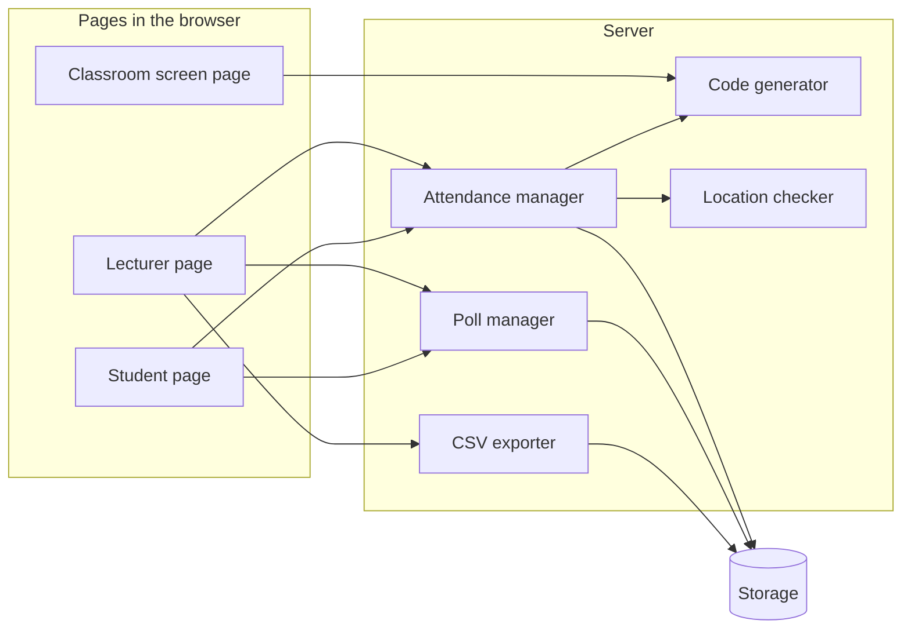

# Software Components

**Project:** Class Attendance & Teaching Tool
**Team:** May Caspi and Haim Barabi
**Related documents:** SRS, Use Cases

This document lists the main parts of the software, what each part does, and which parts talk to each other. It does not describe code. Classes and sequences are in the next document.

## 1. Overview

The system has two sides:

- **Pages in the browser** (what people see): the lecturer page, the classroom screen page and the student page. All of them open in a normal phone or computer browser, with nothing to install.
- **Server** (what works behind the scenes): it creates the codes, checks every check-in, keeps the data and creates the spreadsheet.

## 2. Components

### Pages in the browser

| Component | What it does | Used by | Related requirements |
|-----------|--------------|---------|--------------|
| Lecturer page | Uploads the roster, starts and ends a session, shows the results, downloads the CSV, creates a poll and shows its results. | Lecturer | upload the roster, start and end a session, see the results, download the CSV, create a poll |
| Classroom screen page | Shows the current 4-digit code and the QR code, and updates them when the code changes. | Classroom screen | show the code and QR |
| Student page | The student enters an email and a code (or arrives from the QR code), allows location, sees a confirmation or an error, and answers a poll. | Student | check in, see messages, answer a poll |

### Server

| Component | What it does | Related requirements |
|-----------|--------------|--------------|
| Code generator | Creates the 4-digit code for the current time slot (10-30 seconds) and tells whether a code is the current or the previous one. | changing code, current and previous code |
| Location checker | Calculates the distance between the student's phone and the classroom location, and takes the accuracy of the phone into account. | distance check, flag |
| Attendance manager | The main logic. For each check-in it checks the roster, the code and the location, and records Present or Flagged. It also makes sure there is only one record per student. | roster, code and location checks, one record per student |
| Poll manager | Saves a poll, receives one answer per student and counts the answers. | create a poll, one answer per student, see the results |
| CSV exporter | Builds the spreadsheet for the lecturer (Email, Name, Status, Check-in time, Distance from classroom, Note). | download the CSV |

### Storage

| Component | What it does |
|-----------|--------------|
| Storage | Keeps the roster, the sessions (with the classroom location), the check-ins and the poll answers. In a real system this is a database, so the lecturer uploads the roster once for the course. In the demo it is kept in memory. |

## 3. How the components work together

- **Starting a session:** the lecturer page sends the phone location to the attendance manager, which saves it as the classroom location and starts the session. The classroom screen page asks the code generator for the current code and shows it.
- **A student check-in:** the student page sends the email, the code and the phone location to the attendance manager. The attendance manager asks the code generator if the code is valid, asks the location checker for the distance, looks up the roster in the storage, and saves the result.
- **Getting the spreadsheet:** the lecturer page asks the CSV exporter, which reads the results from the storage and returns a CSV file.
- **A poll:** the lecturer page sends the question to the poll manager. Students answer through the student page, and the answers are saved in the storage.

## 4. Notes

- **Design only, not in this document:** student comments and the class summary (they are described in the use cases as design only).
- **Demo:** for the demo the server can be small, and the exact technology is chosen in the implementation step.
- **Known limit:** in the prototype the secret used to create the code is visible in the browser. In this design the code generator lives on the server, so a real system does not have this problem.
