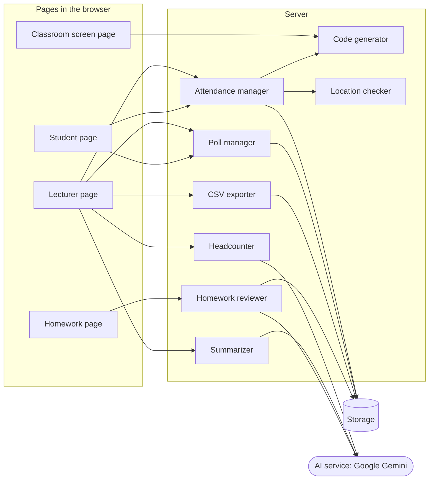

# Software Components

**Project:** Class Attendance & Teaching Tool
**Team:** May Caspi and Haim Barabi
**Related documents:** SRS, Use Cases

This document lists the main parts of the software, what each part does, and which parts talk to each other. It does not describe code. Classes and sequences are in the next document.

## 1. Overview

The system has two sides:

- **Pages in the browser** (what people see): the lecturer page, the classroom screen page, the student page and the homework page. All of them open in a normal phone or computer browser, with nothing to install.
- **Server** (what works behind the scenes): it creates the codes, checks every check-in, keeps the data, creates the spreadsheet and talks to the AI service.

## 2. Components

### Pages in the browser

| Component | What it does | Used by | Related requirements |
|-----------|--------------|---------|--------------|
| Home page and menus | A first page with two tiles (student or lecturer), a student menu (check-in, homework) and a lecturer menu with six tiles (roster, attendance, classroom screen, photo count, class summary, poll). The lecturer menu needs the password, and its tiles open a card of the lecturer page. The design uses blue, white, purple and gray. | Everyone | FR-10, FR-22 |
| Lecturer page | Uploads the roster, starts and ends the start and end check-ins, shows the results and the comments, uploads the classroom photo, uploads a class recording (or a YouTube link) and shows the summary, downloads the CSV, creates a poll and shows its results. | Lecturer | FR-1 to FR-9, FR-18, FR-20, FR-21 |
| Classroom screen page | Shows the current 4-digit code and the QR code, and updates them when the code changes. | Classroom screen | show the code and QR |
| Student page | The student enters an email and a code (or arrives from the QR code), allows location, writes a comment in the end check-in, sees a confirmation or an error, and answers a poll. | Student | FR-10 to FR-17, FR-19 |
| Homework page | The student enters an email and the assignment name, sends a work, and sees the AI review. | Student | FR-22, FR-23 |

### Server

| Component | What it does | Related requirements |
|-----------|--------------|--------------|
| Code generator | Creates the 4-digit code for the current time slot (10-30 seconds) and tells whether a code is the current or the previous one. | changing code, current and previous code |
| Location checker | Calculates the distance between the student's phone and the classroom location, and takes the accuracy of the phone into account. | distance check, flag |
| Attendance manager | The main logic. For each check-in it checks the roster, the code and the location, and records Present or Flagged, for the start or the end round. It combines the two rounds into the lesson status (Present, Late, Left early, Flagged, Absent) and keeps the comments. | FR-1 to FR-7, FR-11 to FR-16, FR-18, FR-19 |
| Poll manager | Saves a poll, receives one answer per student and counts the answers. | create a poll, one answer per student, see the results |
| CSV exporter | Builds the spreadsheet for the lecturer (Email, Name, Status, Start check-in, End check-in, Distance from classroom, Note, Comment). | FR-7 |
| Headcounter | Sends the classroom photo to the AI service, gets the number of people, and compares it with the number of check-ins (ok, warning or information). The photo is not saved. | FR-20 |
| Summarizer | Receives the sound of a class recording (the browser takes it out of the video) or a YouTube link, asks the AI service for a summary in the background, and keeps the result. Only the lecturer gets it. | FR-21 |
| Homework reviewer | Keeps the latest work of each student for each assignment, and asks the AI service for a review that compares it with the student's previous version and with other students' works (anonymous, at most 5, cut to a short length). | FR-22, FR-23 |

### External service

| Component | What it does |
|-----------|--------------|
| AI service (Google Gemini) | Counts the people in a photo, summarizes a class recording and reviews homework. It is used on the free tier. The server calls it with a key that is kept only in the server settings, and the browser never gets the key. |

### Storage

| Component | What it does |
|-----------|--------------|
| Storage | Keeps the roster, the sessions (with the classroom location), the check-ins, the comments, the poll answers, the summary and the homework works. In a real system this is a database, so the lecturer uploads the roster once for the course. In the demo it is kept in memory. |

## 3. How the components work together

- **Starting a session:** the lecturer page sends the phone location to the attendance manager, which saves it as the classroom location and starts the session. The classroom screen page asks the code generator for the current code and shows it.
- **A student check-in:** the student page sends the email, the code and the phone location to the attendance manager. The attendance manager asks the code generator if the code is valid, asks the location checker for the distance, looks up the roster in the storage, and saves the result.
- **Getting the spreadsheet:** the lecturer page asks the CSV exporter, which reads the results from the storage and returns a CSV file.
- **A poll:** the lecturer page sends the question to the poll manager. Students answer through the student page, and the answers are saved in the storage.
- **Photo count:** the lecturer page sends the photo to the headcounter, which gets the number from the AI service and compares it with the number of check-ins.
- **Class summary:** the lecturer page takes the sound out of the recording and sends it to the summarizer, which gets the summary from the AI service in the background. The page asks every few seconds until it is ready. Only the lecturer page can read it.
- **Homework:** the homework page sends the work to the homework reviewer. The reviewer sends the work and the other works to the AI service, saves the work and returns only the review.

## 4. Notes

- **AI:** the AI answers are a help and can be wrong. The photo count is a warning, and the homework review is advice.
- **Demo:** for the demo the server can be small, and the exact technology is chosen in the implementation step.
- **Known limit:** in the prototype the secret used to create the code is visible in the browser. In this design the code generator lives on the server, so a real system does not have this problem.
