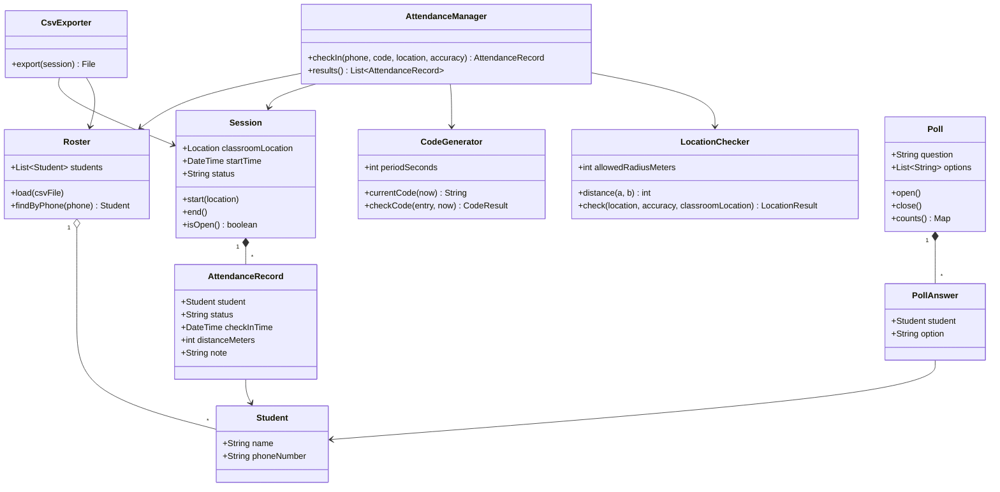
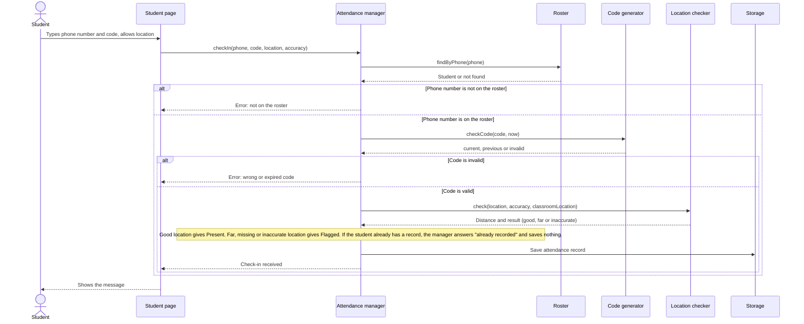
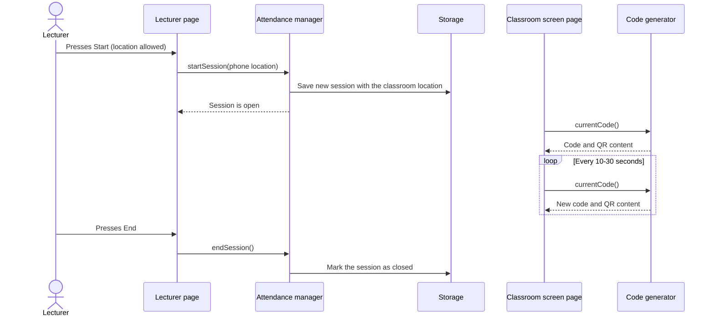
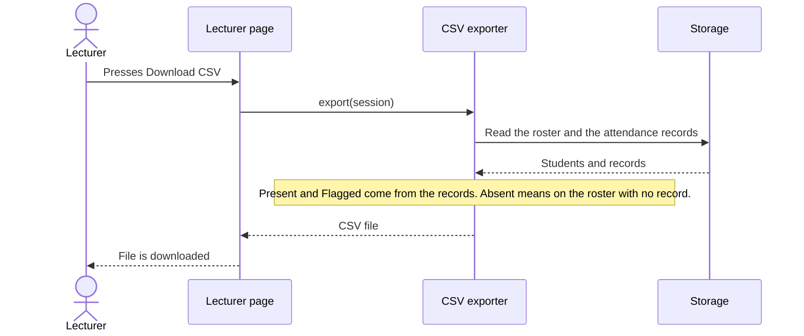

# Class Diagram and Sequence Diagrams

**Project:** Class Attendance & Teaching Tool
**Team:** May Caspi and Haim Barabi
**Related documents:** SRS, Use Cases, Software Components

This document goes one level below the components. The class diagram shows the main classes of the demo, what each one holds and does, and how they are connected. The sequence diagrams show three important scenarios step by step, in time order.

## 1. Class diagram

### What each class is for

| Class | Purpose | Related requirements |
|-------|---------|----------------------|
| Student | A student: name and phone number. | identify by phone number |
| Roster | The course student list. Loads it from a CSV file and finds a student by phone number. | upload the roster, identify by phone number |
| Session | One attendance session: the classroom location, the start time and whether it is open or closed. | start and end a session |
| CodeGenerator | Creates the 4-digit code for the current time slot (10-30 seconds) and tells if an entered code is the current one, the previous one or invalid. | changing code, current and previous code |
| LocationChecker | Calculates the distance between the phone and the classroom, and decides if the location is good, far or too inaccurate. | distance check, flag |
| AttendanceRecord | One check-in of one student: status (Present or Flagged), time, distance and a note. | flag, one record per student |
| AttendanceManager | The main logic. It checks the roster, the code and the location for each check-in, and keeps one record per student. | roster, code and location checks, one record per student |
| Poll | A quick poll: a question, answer options, and the counting of answers. | create a poll, see the results |
| PollAnswer | One answer of one student. A student can answer once. | answer a poll once |
| CsvExporter | Builds the spreadsheet for the lecturer. | download the CSV |

Notes:
- **Absent** is not saved. A student is Absent when they are on the roster and have no attendance record in the session.
- Student comments and the class summary are design only and are not in the class diagram.

## 2. Sequence diagram: a student checks in

This is the main scenario (use case UC-3). It shows the checks in order: roster, code, location.

## 3. Sequence diagram: the lecturer starts a session

This scenario is use case UC-2. It shows how the classroom location is saved and how the classroom screen gets the code.

## 4. Sequence diagram: the lecturer downloads the spreadsheet

This scenario is use case UC-4.

