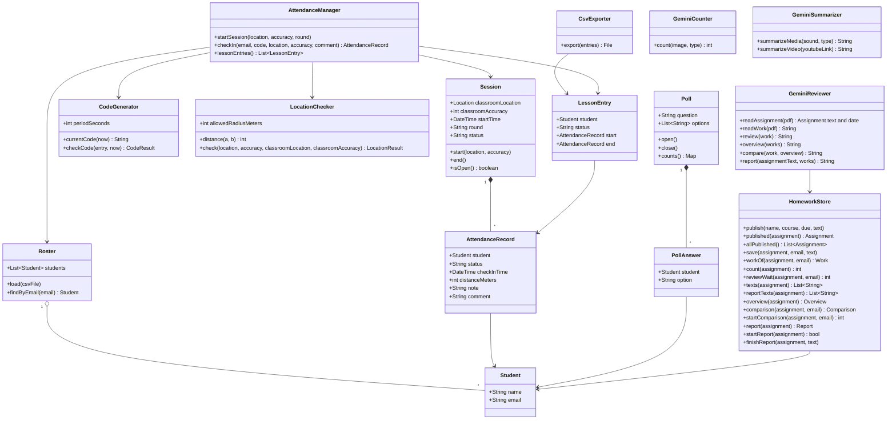
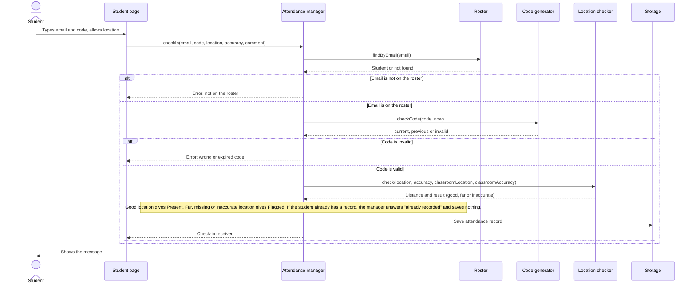
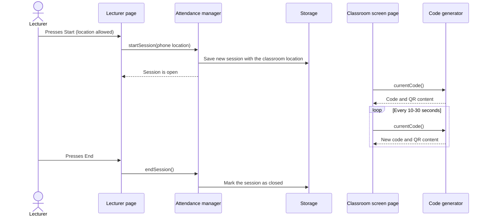
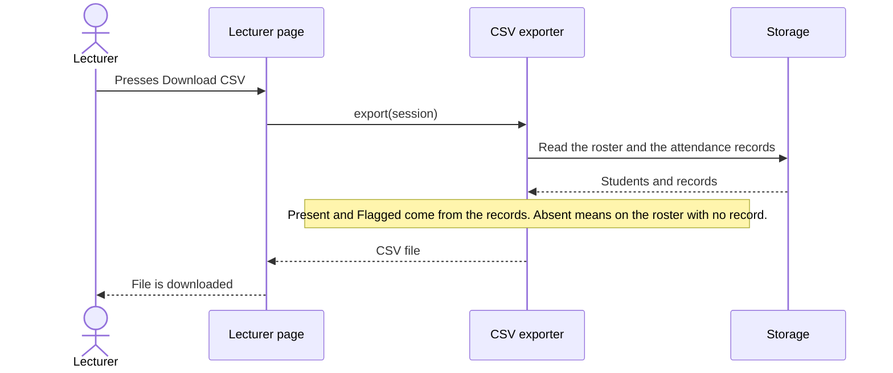
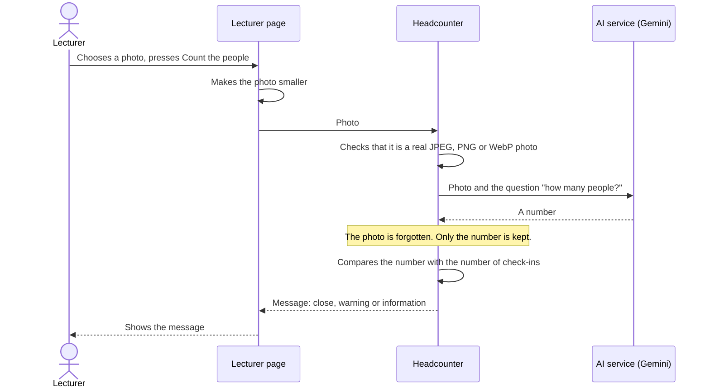
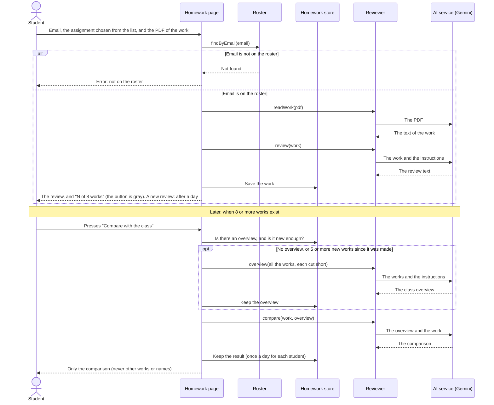
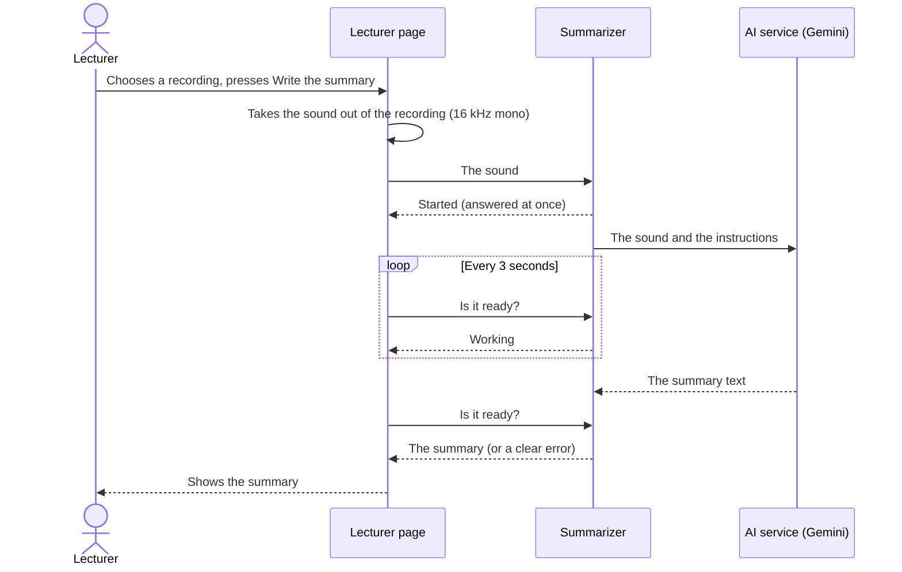
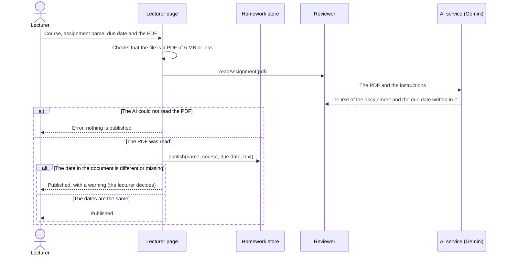
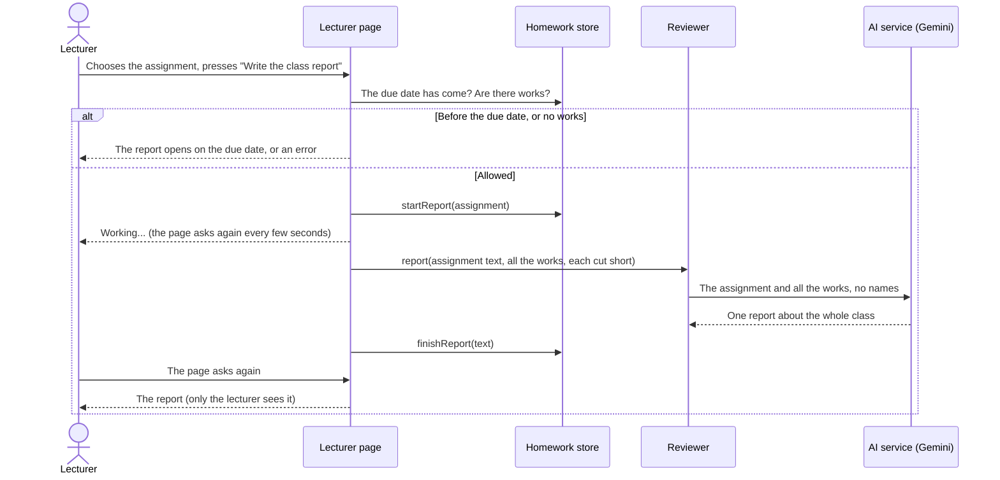

# Class Diagram and Sequence Diagrams

**Project:** Class Attendance & Teaching Tool
**Author:** May Caspi
**Related documents:** SRS, Use Cases, Software Components

This document goes one level below the components. The class diagram shows the main classes of the demo, what each one holds and does, and how they are connected. The sequence diagrams show the important scenarios step by step, in time order.

## 1. Class diagram

### What each class is for

| Class | Purpose | Related requirements |
|-------|---------|----------------------|
| Student | A student: name and email. | FR-11 |
| Roster | The course student list. Loads it from a CSV file and finds a student by email. | FR-1, FR-11 |
| Session | One check-in round ("start" or "end" of the class): the classroom location, the start time and whether it is open or closed. | FR-2, FR-5, FR-18 |
| LessonEntry | One student in the whole lesson: the start record, the end record and the combined status (Present, Late, Left early, Flagged or Absent). | FR-6, FR-18 |
| CodeGenerator | Creates the 4-digit code for the current time slot (10-30 seconds) and tells if an entered code is the current one, the previous one or invalid. | FR-3, FR-4 |
| LocationChecker | Calculates the distance between the phone and the classroom, and decides if the location is good, far or too inaccurate. The allowed distance grows with the two accuracies (each up to 300 m). | FR-13, FR-14, FR-25 |
| AttendanceRecord | One check-in of one student in one round: status (Present or Flagged), time, distance, a note and the comment about the lesson. | FR-14, FR-16, FR-19 |
| AttendanceManager | The main logic. It checks the roster, the code and the location for each check-in, and keeps one record per student. | FR-11, FR-13, FR-14, FR-16, FR-24 |
| Poll | A quick poll: a question, answer options, and the counting of answers. | FR-8, FR-9 |
| PollAnswer | One answer of one student. A student can answer once. | FR-17 |
| CsvExporter | Builds the spreadsheet for the lecturer from the lesson entries. | FR-7 |
| GeminiCounter | Sends a photo to the AI and returns the number of people. The comparison with the check-ins is a separate function that gives ok, warning or information. | FR-20 |
| GeminiSummarizer | Sends the sound of a recording, or a YouTube link, to the AI and returns the summary. It runs in the background. | FR-21 |
| HomeworkStore | Keeps the published assignments (course, name, due date and the text read from the PDF), the work of each student for each assignment (in memory, with a limit), the class overview, the state of each comparison (once a day for each student), and the class report for the lecturer. | FR-22, FR-23, FR-27, FR-28 |
| GeminiReviewer | Asks the AI to read the PDF of an assignment (its text and its due date) or of a work (its text), for one review of a work, for one overview of all the works, for the comparison of a work with the overview, and for one report about all the works of an assignment. | FR-22, FR-23, FR-27, FR-28 |

Notes:
- **Absent** is not saved. A student is Absent when they are on the roster and have no attendance record in the session.
- The AI classes call the Google Gemini service. In the tests they are replaced by fake classes, so no real AI is called.

## 2. Sequence diagram: a student checks in

This is the main scenario (use case UC-3). It shows the checks in order: roster, code, location.

## 3. Sequence diagram: the lecturer starts a session

This scenario is use case UC-2. It shows how the classroom location is saved and how the classroom screen gets the code.

## 4. Sequence diagram: the lecturer downloads the spreadsheet

This scenario is use case UC-4.

## 5. Sequence diagram: the lecturer counts the people in a photo

This scenario is use case UC-5.

## 6. Sequence diagram: homework review and the comparison with the class

This scenario is use case UC-8. The assignment was published by the lecturer (section 8). The review comes first. The comparison opens when enough works exist.

## 7. Sequence diagram: the lecturer gets a summary of the class

This scenario is use case UC-7. The AI can take longer than the server allows for one request, so it works in the background and the page asks again.

## 8. Sequence diagram: the lecturer publishes an assignment

This scenario is use case UC-9. The students can choose the assignment only after it is published.

## 9. Sequence diagram: the lecturer gets a report about all the works

This scenario is use case UC-10. The AI can be slow, so it works in the background and the page asks again.

